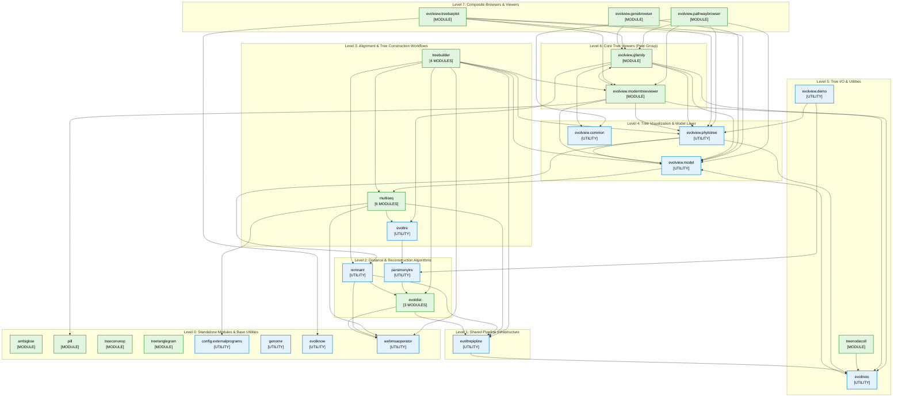

# Module Dependency DAG and Architecture Layers

## Overview

This document describes the package-level dependency architecture for the `src/module/` ecosystem in `egps-pathway.evol.browser`.

**Current source facts**

- **Total top-level functional packages (`src/module/**`):** 26
- **Packages containing `IModuleLoader` entries:** 13 (5 direct single-module packages, 5 `evolview.*` browser/viewer packages, and 3 multi-module parent packages `evoldist`, `multiseq`, `treebuilder`)
- **Support / utility packages:** 13
- **Total standalone modules:** 23
- **Logical architecture layers:** 7

---

## Architectural Principles and Real Source Coupling

1. **Downward logical layering**: High-level browser and viewer modules (`pathwaybrowser`, `treebarplot`, `genebrowser`) sit at the top layer and consume lower-level tree models (`evolview.model`, `evolview.phylotree`), I/O parsers (`evoltreio`), and shared UI utilities (`evolview.common`).
2. **Shared tree panel and parameter parser peer group (`gfamily <-> moderntreeviewer`)**:
   - `evolview.moderntreeviewer` reuses `PhylogeneticTreePanel`, `GeneFamilyController`, and layout/operation control panels hosted under `evolview.gfamily`.
   - `evolview.gfamily` reuses `MTVImportInforBean`, `ParamsAssignerAndParser4ModernTreeView`, `TreeParser4MTV`, and `TreePropertiesAssigner` from `evolview.moderntreeviewer`, and opens clade subtrees in new MTV tabs via `IndependentModuleLoader`.
3. **Result viewer handoff (`treebuilder -> moderntreeviewer`)**:
   - All 4 tree-construction modules under `treebuilder` invoke `evolview.moderntreeviewer.IndependentModuleLoader` after tree reconstruction to display the resulting phylogeny in Modern Tree View.
4. **Full-project compilation**:
   - Because of the peer sharing above and configuration/model cross-references (`evoltrepipline -> evoltreio -> evolview.model -> multiseq`), all `src/**/*.java` sources are compiled together in a single `javac` pass (`compile.bat` / `compile.sh`).

Read the graph below as `A --> B`, meaning `A` imports from `B`.

---

## Dependency Graph

---

## Layer Summary

| Level | Role | Packages |
|-------|------|----------|
| 0 | Standalone modules & base utilities | `ambigbse` [1], `pill` [1], `treeconveop` [1], `treetanglegram` [1], `config.externalprograms`, `genome`, `evolknow`, `webmsaoperator` |
| 1 | Shared pipeline infrastructure | `evoltrepipline` |
| 2 | Distance & reconstruction algorithms | `evoldist` [3], `remnant`, `parsimonytre` |
| 3 | Alignment & tree construction workflows | `multiseq` [6], `treebuilder` [4], `evoltre` |
| 4 | Tree visualization & model layer | `evolview.model`, `evolview.phylotree`, `evolview.common` |
| 5 | Tree I/O & node collection | `evoltreio`, `treenodecoll` [1], `evolview.demo` |
| 6 | Core tree viewers (peer group) | `evolview.moderntreeviewer` [1], `evolview.gfamily` [1] |
| 7 | Composite browsers & viewers | `evolview.pathwaybrowser` [1], `evolview.treebarplot` [1], `evolview.genebrowser` [1] |

*(Bracketed numbers `[N]` indicate the number of standalone `IModuleLoader` implementations in each package; total = 23.)*
