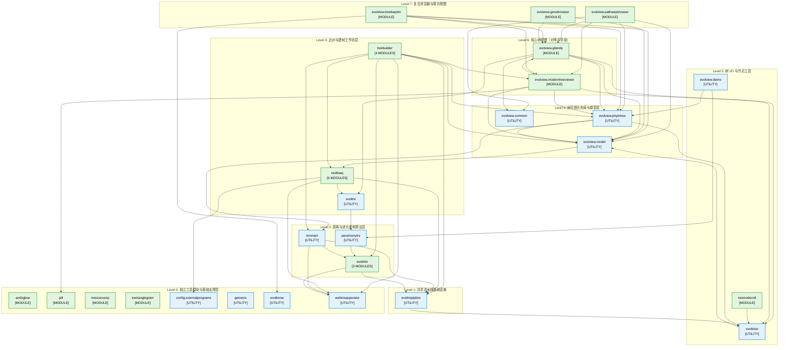

# 模块依赖图与分层架构（DAG & Layers）

## 概览

本文描述 `egps-pathway.evol.browser` 仓库中 `src/module/` 模块生态当前的包级依赖结构。

**当前源码事实**

- **顶层功能子包总数（`src/module/**`）：** 26
- **包含 `IModuleLoader` 入口的包：** 13（5 个单模块直接包、5 个 `evolview.*` 可视化模块包，以及 `evoldist`、`multiseq`、`treebuilder` 3 个多模块父包）
- **支撑与工具包：** 13
- **独立模块加载入口总数：** 23
- **逻辑架构分层：** 7 层

---

## 架构分层原则与真实源码耦合说明

1. **自顶向下的主逻辑分层**：高层复合浏览器（`pathwaybrowser`、`treebarplot`、`genebrowser`）位于最顶层，只向下消费核心树视图（`gfamily`、`moderntreeviewer`）、树模型与布局层（`evolview.model`、`evolview.phylotree`）、I/O 解析层（`evoltreio`）以及公共 UI 工具（`evolview.common`）。
2. **核心树视图对等共享组（`gfamily <-> moderntreeviewer`）**：
   - `evolview.moderntreeviewer` 复用了位于 `evolview.gfamily` 下的共享树画布 `PhylogeneticTreePanel`、控制器基类 `GeneFamilyController` 及布局/操作面板。
   - `evolview.gfamily` 复用了位于 `evolview.moderntreeviewer` 下的 `MTVImportInforBean`、`ParamsAssignerAndParser4ModernTreeView`、`TreeParser4MTV` 与 `TreePropertiesAssigner`，并在右键“在新标签页查看子树”时通过 `IndependentModuleLoader` 打开 MTV。
3. **计算流水线结果跳转（`treebuilder -> moderntreeviewer`）**：
   - `treebuilder` 下的 4 个建树模块在建树完成后，均直接调用 `evolview.moderntreeviewer.IndependentModuleLoader` 将生成的 `GraphicsNode` 树展示在 Modern Tree View 中。
4. **全量统一编译**：
   - 由于存在上述对等组件共享以及配置/模型跨包引用（`evoltrepipline -> evoltreio -> evolview.model -> multiseq`），工程编译采用单次 `javac` 全量编译（见 `compile.bat` / `compile.sh`）。

下图中 `A --> B` 表示包 `A` 引用（`import`）了包 `B`。

---

## 包级依赖关系图

---

## 分层摘要

| 层级 | 角色 | 包含的包 |
|------|------|----------|
| 0 | 独立工具模块与基础支撑层 | `ambigbse` [1]、`pill` [1]、`treeconveop` [1]、`treetanglegram` [1]、`config.externalprograms`、`genome`、`evolknow`、`webmsaoperator` |
| 1 | 共享流水线基础设施 | `evoltrepipline` |
| 2 | 距离与进化重构算法层 | `evoldist` [3]、`remnant`、`parsimonytre` |
| 3 | 比对与建树工作流层 | `multiseq` [6]、`treebuilder` [4]、`evoltre` |
| 4 | 树可视化布局与模型层 | `evolview.model`、`evolview.phylotree`、`evolview.common` |
| 5 | 树 I/O 与节点收集工具 | `evoltreio`、`treenodecoll` [1]、`evolview.demo` |
| 6 | 核心树视图（对等共享组） | `evolview.moderntreeviewer` [1]、`evolview.gfamily` [1] |
| 7 | 复合浏览器与联合视图 | `evolview.pathwaybrowser` [1]、`evolview.treebarplot` [1]、`evolview.genebrowser` [1] |

*（方括号 `[N]` 表示该包下包含的独立 `IModuleLoader` 数量，总计 23 个。）*
