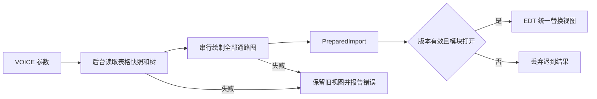

# Pathway Family Browser 修复 Walkthrough

更新：2026-11-08。修复基线：`9854633`。

本文替换此前“100% 完成、亚毫秒合成”的过度结论。验收以可重复测试和实际画面为依据，未测量的性能、全部 SVG 特性、所有 PowerPoint 文件均不作保证。

## 本轮修改

### 1. 数据正确性

提交 `fc039bf`。

- POI 继续实际计算受支持公式；不支持、求值错误、没有求值结果均明确失败，不再读取公式缓存。文件导入错误包含文件、工作表、行列及公式。
- `GeneMatch` 增加已知成员数、总成员数与完整度方法，保留原访问方法及四参构造器。`BannerStats` 增加部分缺测标记并保留三参构造器。
- 家族角标、类别框和 Copies 语义统一；基因与类别重复出现仍只统计一次。
- 两个 Xenopus 科学名属于独立物种；泛称仅允许唯一候选。全部分析面板沿用同一名称解析器，并统一空白、下划线及连字符。

| 数据 | 结果 |
| --- | --- |
| `{2, NA}` | `≥2`，已知下界 |
| `{0, NA}`、全部缺测 | `?`，清晰显示 |
| `{0, 0}` | `0`，淡化 |
| 全部已知 | 精确总数 |
| 无对应映射 | 原图外观，不叠加计数 |

### 2. 图形保真

提交 `5ae2318`。

- SVG 原始 DOM 不再被切片修改。预建本地引用索引，检查重复 ID、失效引用及循环引用。
- 每个切片保留原定义，为引用目标及必要祖先上下文生成私有副本和唯一 ID；同步处理 `href`、`xlink:href`、`url(#id)` 和 ID 样式选择器。仅移除切片外的绘制实例，继续交给 JSVG 绘制。
- 显式实例基因绑定优先；未绑定引用保持静态。失败和空动态切片向上传播，不用空图代替成功结果。
- PPTX 父组水平/垂直镜像、旋转和内部坐标映射共同参与角标及空间匹配计算；保留实际透明像素裁剪。
- 正尺寸检查覆盖 PPTX/SVG；完整 PPTX 绘制异常不再吞掉。

### 3. 导入、导出与关闭

流程修复及本轮文档位于第三批提交。

- 准备期间显示进度。挂载画廊与分析表时使用已准备的图片和表格快照，不重新读文件。
- 任意一张图失败不进入替换阶段；旧树、分析页、布局和选择对象保留。
- 通路导出使用独立完整图片快照，尺寸取缓存图片，不取视口；未就绪提示，保存调用为零。
- 保留三参 `SaveUtil.saveData(panel, getClass(), null)`。PNG 验收实际经过 SaveUtil 保存后端并读回文件。
- 异步导入和画廊保留实际 SwingWorker，取消时同时取消 worker 和令牌。关闭先置标记、使版本失效，再取消任务；错误通知、成功提交和延迟切页受保护。

## 验证与证据

统一入口：`pwsh -NoProfile -ExecutionPolicy Bypass -File scripts/test_pathway_remaining_fixes.ps1`。

脚本先全量编译，再运行原有 7 套及新增 4 套测试；每套使用隔离的 `user.home`。结果记录到 [remaining-test-results.json](../../logs/remaining-test-results.json)，逐套日志位于 `logs/remaining-<测试类>.log`。

| 新增测试 | 主要断言 |
| --- | --- |
| `RemainingDataRegressionTest` | 无缓存不支持公式；正常 SUM；四种缺测组合；家族/类别/Copies 一致并去重；科学名隔离、泛称歧义及连字符 |
| `RemainingGraphicsRegressionTest` | 7 个 SVG 引用/样式场景，切片重组与原图逐像素一致；12 个 PPTX 镜像/旋转/嵌套组合与 POI 实际像素边界比对 |
| `RemainingCanvasLifecycleTest` | SaveUtil PNG 实际保存读回，420×260 及两端边缘像素；视口缩小后仍完整；门闩控制 worker 启动、取消及完成 |
| `RemainingImportLifecycleTest` | 第二张坏图、零尺寸、空切片、注入绘制异常保留旧对象；关闭前完成的错误不再通知；关闭前排队成功不再提交；未就绪保存调用为零 |

原有 7 套：`PathwayReviewRegressionTest`、`AnalysisPanelDataPreparationTest`、`AbstractAnalysisPanelAsyncTest`、`AnalysisPanelLoadVersionTest`、`PathwayExampleDirectoryTest`、`PathwayBrowserExamplesTest`、`PathwayBrowserWorkflowTest`。

新增生命周期断言使用门闩、Future 和 DONE 信号，未使用固定 sleep 判断任务完成。原有工作流截图测试仍包含等待画面稳定的 sleep，其用途是示例画面检查，不作为竞态修复的唯一证据。

6 个示例通过真实 VOICE 导入并加载 Swing 面板；画面保存在 `temp/pathway-workflow-1.png` 至 `temp/pathway-workflow-6.png`，已逐张查看。第 1 个显示绑定计数的 Wnt 图；第 2–5 个显示 WikiPathways 参考画廊；第 6 个显示 64 叶环形树及计数表。静态参考图不因选中物种而自动增加基因映射。

前两批独立验证另存 `logs/remaining-stage1-build.log`、`logs/remaining-stage1-test.log`、`logs/remaining-stage2-test.log`。

## 保留的限制

- SVG 渲染范围由现有 JSVG 决定；本地引用隔离不扩展其 CSS 语法或滤镜支持。外部 `use` 引用明确拒绝，不下载外部资源。
- PPTX 只读取第一页；测试比较 POI 实际绘制结果，没有声称与 Microsoft PowerPoint 所有效果一致。几何边界比对容许小于 4 像素的边缘差异；最终精灵仍按实际像素裁剪。
- 全部图预处理比懒加载等待更久、占用更多内存，这是统一切换的已选策略。取消是协作式的，第三方正在执行的单次绘制可能先返回，再丢弃结果。
- 示例 4 的内部标签与横枝相交；示例 6 默认尺寸下叶标签较密。这是既有布局可读性限制，本轮未修改 MTV 布局；可放大画布或调整标签。
- 真实导出覆盖 PNG 后端；PDF、SVG、EPS、PPTX 等其他保存格式未逐一验收。缓存快照导出不承诺保留原始文件的可编辑矢量结构。

逐项问题与状态见 [剩余问题修复记录](pathway_family_browser_remaining_fixes_2026-11-08_zh.md)。
