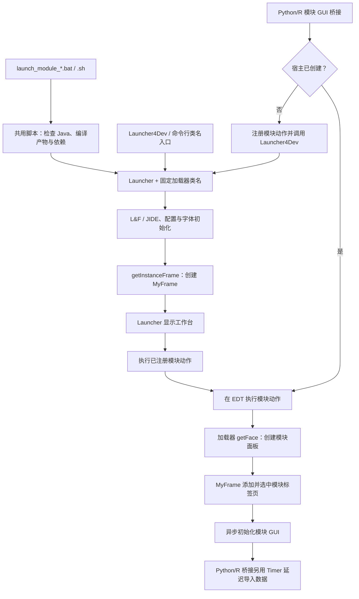
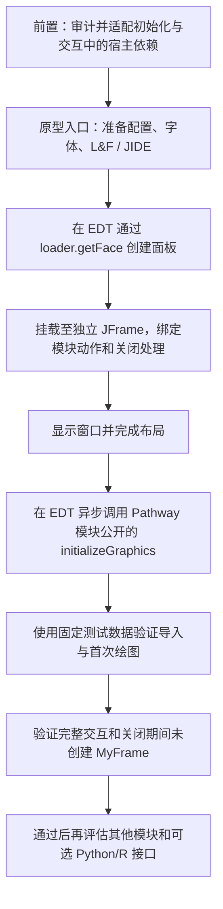

# eGPS2 模块启动机制与独立窗口可行性评估

> **文档性质**：当前实现说明与后续架构规划；独立窗口方案尚未实现、尚未验证。
>
> **核对基线**：`17a3c2b`，2026-10-17。
>
> **适用范围**：当前工程的模块启动脚本；脱离宿主的评估以 Pathway family browser 为试点，不代表其他模块已兼容。

## 1. 当前结论

1. **已实现：通过脚本直接打开指定模块。** `launchers/` 包含 23 对 `launch_module_<模块名>.bat` / `.sh` 入口，以及 `_launch_module_common.bat`、`_launch_module_common.sh` 两个共用脚本。它们启动 eGPS2 工作台，再自动打开并选中目标模块。
2. **源码确认：现有标准模块 GUI 入口仍依赖宿主。** `egps2.Launcher`、`Launcher4Dev` 和现有主要 Python/R 模块 GUI 桥接均使用 `MyFrame`。完整工作台启动不等于打开所有模块界面：模块会被扫描登记，目标视图按需创建。此结论不涵盖独立工具窗口或不需要 GUI 的计算调用。
3. **待验证：脱离工作台的独立窗口。** `PathwayFamilyMainFace` 经 `ModuleFace` 继承自 Swing `JPanel`，具备放入独立 `JFrame` 的结构基础，但初始化、导入和交互过程中存在多层宿主依赖。不能据此断言只替换几个弹窗父窗口即可完整运行。

## 2. 当前实现与使用边界

### 2.1 模块启动脚本（已实现）

Windows 示例：

```powershell
.\launchers\launch_module_pathway_family_browser.bat
```

WSL 示例：

```bash
bash launchers/launch_module_pathway_family_browser.sh
```

脚本自动定位项目根目录，可从其他目录调用，并处理空格、中文路径；优先使用 `JAVA_HOME`，否则查找 `PATH` 中的 Java，要求 JDK 25 或更高版本。须先完成对应平台的编译与资源复制，并准备 `dependency-egps/` 依赖；脚本不自动编译，默认最大堆内存为 `12g`。

Windows 使用现有 `eGPS.args` 和分号分隔的 classpath；WSL 脚本使用 Linux Java、冒号分隔的 classpath，保留可移植 JVM 参数并排除 Windows 专用参数。每个入口固定传入一个模块加载器类名，不透传额外参数，数据通过模块界面导入。Windows 失败时暂停显示错误并保留 Java 退出码。

**WSL 需要 Linux JDK 25 和 WSLg 或已配置的 X Server；脚本尚未进行 WSL 运行验证，由使用者自行验证。** 完整模块后缀清单见 [中文 README](README_zh.md#模块启动脚本) 和 [英文 README](README.md)。

### 2.2 宿主启动与模块挂载（源码确认）

- `Launcher4Dev.main()` 设置 `Launcher.isDev = true` 后委托 `Launcher.main()`；生产入口直接使用 `Launcher`，当前模块脚本使用后者。
- `Launcher` 初始化 Look & Feel、JIDE、配置和字体，通过 `UnifiedAccessPoint.getInstanceFrame()` 创建宿主，再显式调用 `setVisible(true)` 显示工作台。
- 加载器类名参数经 `registerActionAfterMainFrame()` 注册，主框架就绪后反射创建加载器，通过 `loadTheModuleFromIModuleLoader()` 获取面板并挂载标签页。挂载、选择及 GUI 初始化被调度到 EDT。
- `getInstanceFrame()` 在单例为空时创建完整 `MyFrame`，但该方法本身不调用 `setVisible(true)`。隐式创建宿主与显示工作台窗口必须区分。
- `ExternalGuiLauncherSupport` 在已有宿主时复用它，否则注册动作并调用 `Launcher4Dev`。动作先挂载模块，再使用一次性 Swing Timer 延迟 1500ms 导入配置数据；并非由定时器挂载模块。

## 3. 架构流程对比

### 3.1 当前链路：脚本直接定位模块，仍启动完整工作台



图中最后的数据导入步骤只适用于该 Python/R 桥接；普通脚本不接收数据参数，模块可能自行打开导入界面。

### 3.2 后续设想：独立窗口（尚未实现，须先完成依赖适配）



该图描述未来原型的目标顺序，不能直接套用当前代码运行。耗时读取和计算需在后台进行，Swing 组件创建、更新及显示仍在 EDT；不能用把整个初始化移到后台的方式规避阻塞。

## 4. 独立窗口的实际依赖与限制

以下为源码确认的主要依赖，并非完整的全工程兼容性证明。

| 要素 | 当前事实 | 后续适配与验证要求 |
| :--- | :--- | :--- |
| 环境与配置 | 面板、控制器及子组件读取 `UnifiedAccessPoint.getLaunchProperty()`；路径依赖 `EGPSProperties`。当前启动器还处理配置、字体注册及全局字体应用。 | 不能只安装 JIDE 扩展；需验证首次运行、已有配置、字体、资源和持久化目录。 |
| 控制器与状态栏 | `PathwayFamilyMainFace.initializeTheModule()` 创建 `PathwayBrowserController`，后者字段初始化直接调用 `getInstanceFrame()`，搜索结果也写入宿主状态栏。 | 仅创建独立容器无法避免宿主实例化；须适配控制器的窗口和状态反馈。 |
| VOICE 导入 | `initializeGraphics()` 最后调用 `importData()`，打开 VOICE 导入界面，不会自动生成树图与通路图。公共 VOICE 基类直接获取宿主作为对话框 owner，并使用宿主忙闲状态；书签和输入区域也存在宿主引用。 | 必须审计导入、执行、忙闲切换、书签和错误路径，不能只替换模块内的弹窗 owner。 |
| 统计与成就 | `ModuleFace` 构造器的 `isGULaunched()` 守卫仅跳过构造阶段统计。`Voice4pathwayFamilyBrowser.execute()` 调用功能统计，首次功能通知仍可能无条件获取宿主。 | 不能认定统计系统天然兼容；需处理运行期间通知，并验证首次使用路径。 |
| 树交互与弹窗 | 搜索、字体、折叠等对话框及共享 `TreeListener` 使用宿主窗口、状态栏或右侧属性面板。树右键菜单还可经宿主加载另一模块。 | 弹窗可评估组件所属窗口；状态反馈、属性编辑与跨模块动作需分别设计，不能归结为 owner 替换。 |
| 公共对话框工具 | shell 中 `EGPSFileChooser` 的无参显示方法及部分 `SwingDialog` 包装方法会直接获取宿主。 | 需沿实际调用链核对；不能认为替换本模块三处调用就完成解耦。 |
| 初始化可见性 | `PathwayFamilyMainFace` 构造器为 `protected`；`ModuleFace.initializeModuleFaceGUI()` 为包级方法，普通测试包无法直接调用。 | Pathway 原型通过公开的 `loader.getFace()` 创建面板，并以 `PathwayFamilyMainFace` 类型调用其公开的 `initializeGraphics()`；先挂载和布局，再初始化一次。此方法不是全部模块的通用公共契约。 |
| 动作、关闭与持久化 | 宿主菜单动作通常以当前标签为目标；`ModuleFace.moduleExisted()` 是包级方法，还承担统计持久化及引用释放。Pathway 的 `closeTab()` 保存界面状态。 | 独立菜单须显式绑定目标面板；仅 `dispose()` 或调用 `closeTab()` 不等价于完整宿主关闭流程。当前 Pathway `exportData()` 中实际保存调用被注释，不能把添加菜单等同于导出已实现。 |
| 其他模块 | 23 个入口对应不同模块；如 `ComputationalModuleFace` 的运行逻辑仍依赖宿主工具栏和进度反馈。 | 先验证 Pathway 单模块，再逐模块评估，不能由其继承 `JPanel` 推导所有模块可独立运行。 |

上述公共依赖位于 `egps-shell`，本工程不能直接修改其源码。后续若确需新增通用生命周期或宿主服务接口，应由维护者在 shell 工程单独评估实施；本次仅修正文档。

### 核对依据

- 当前实现：`launchers/_launch_module_common.bat`、`launchers/_launch_module_common.sh`、中英文 README 的模块启动脚本说明。
- 启动与生命周期：`../egps-shell/src/egps2/Launcher.java`、`UnifiedAccessPoint.java`，以及该工程 `src/egps2/frame/` 下的 `MyFrame.java`、`ModuleFace.java`、`ComputationalModuleFace.java`。
- 本模块链路：`src/module/evolview/pathwaybrowser/` 下的 `PathwayFamilyMainFace.java`、`PathwayBrowserController.java`、`io/Voice4pathwayFamilyBrowser.java`，以及共享树组件与监听器。
- 公共导入与桥接：shell 的 `VersatileOpenInputClickAbstractGuiBase.java`、对话框工具，以及本工程 `src/api/rpython/ExternalGuiLauncherSupport.java`。

## 5. 后续实施路线与验收（尚未实施）

### 阶段一：依赖审计与适配范围确认

- 以 Pathway 的创建、初始化、导入、树交互及关闭为主线，区分模块内依赖与 shell 公共依赖，明确需要维护者支持的部分。
- 确定独立模式下状态栏、属性编辑及“在新标签中查看子树”等跨模块功能的替代行为，再开展原型；不能默认沿用宿主动作。
- 保留现有工作台和脚本入口，避免为了原型改变现有用户行为。

### 阶段二：Pathway 单模块原型与完整交互验证

- 前置依赖适配完成后，在 `src/test/` 下建立原型入口，不放到模块根目录。通过加载器获得面板，在 EDT 创建容器、完成挂载和布局后，调度该模块公开的初始化方法。
- 使用固定输入数据验证导入、首次绘图、缩放、节点选择、搜索、字体、折叠、错误弹窗、调整窗口大小、关闭持久化及重复打开；导出按现有能力或另行实现的范围验收，不承诺当前已有完整导出能力。
- 在全新 JVM 中检查 `UnifiedAccessPoint.isGULaunched()`：它以宿主单例是否为空为依据，应在初始化及上述交互后始终为 `false`，避免只检查是否出现工作台窗口。
- 在相同 JDK、机器、输入和配置下分别记录冷启动、热启动的窗口可见时间、首次有效绘图时间和 JVM 内存。当前没有测量结果，不承诺耗时或节省比例。

### 阶段三：其他模块与可选 Python/R 集成

- 原型通过后，再评估其他模块的初始化、计算任务、窗口动作与关闭契约，不默认向全部 23 个模块推广。
- Python/R 独立窗口作为显式可选入口或模式研究，保留现有模块桥接和桌面启动的默认行为；验证数据导入时序及线程模型，不把移除 1500ms 定时器等同于实际性能收益。
- 外部桥接须验证关闭独立窗口不会终止调用方 JVM，并确认多次调用、已有工作台及异常恢复的行为。

## 6. 本次文档核对范围

本次根据 `17a3c2b` 的脚本、README、当前模块源码及只读的 shell 源码校正文档，区分已实现行为与未来设想。未新增独立窗口实现，未修改 Java 接口、启动脚本或依赖源码；未执行 WSL 运行验证。
