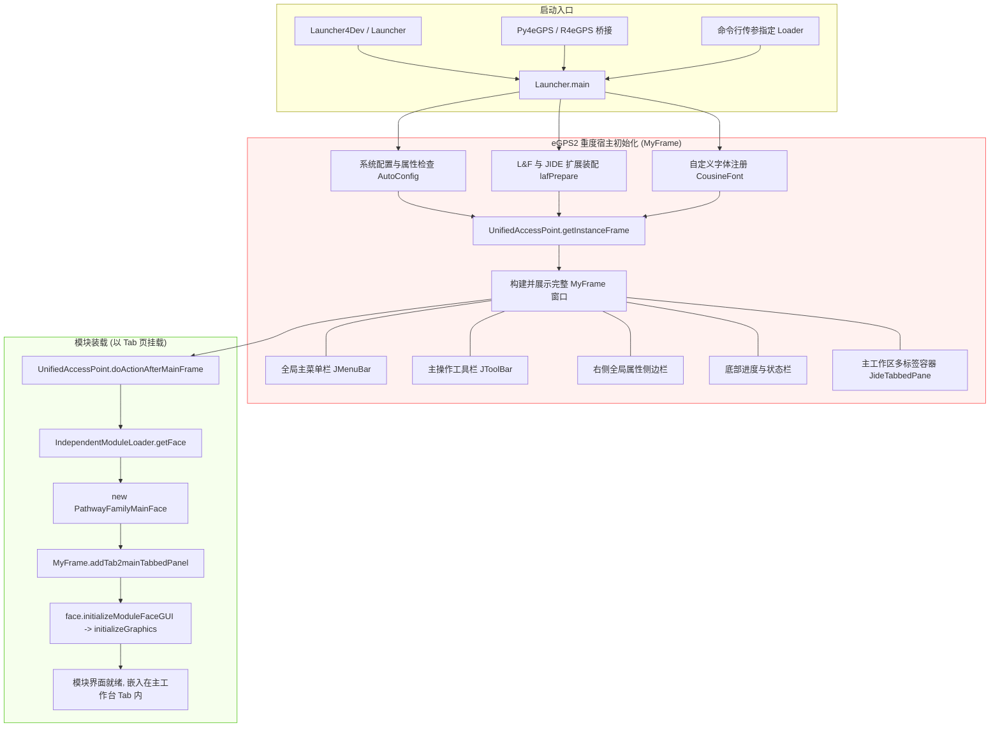
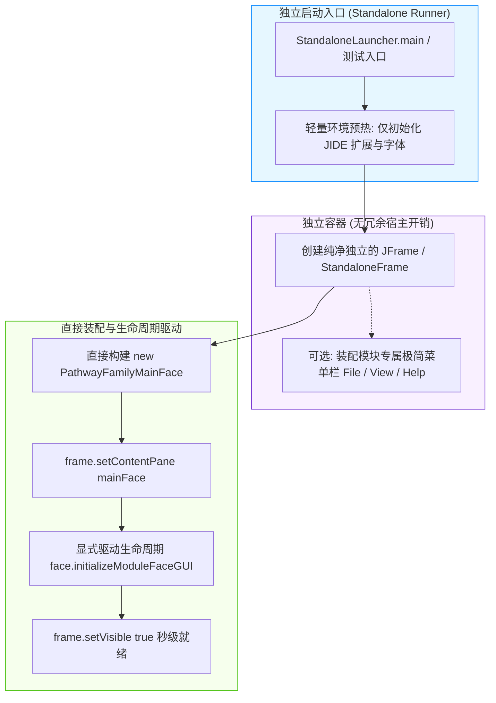

# eGPS2 模块启动机制剖析与独立直接启动（Standalone）规划方案

> **文档性质**：架构规划与可行性评估报告（规划阶段）  
> **适用模块**：`egps-pathway.evol.browser`（及基于其模板衍生的 `egps-mutationPre`、`egps-sanky-venn`、`egps-heatmap` 等应用模块）  
> **创建日期**：2026-10-17  

---

## 1. 核心问题定位

**问题**：现在要启动模块，是不是必须启动整个 eGPS2？有没有可能直接启动？

**结论**：
1. **现状**：**是的，目前无论通过命令行、开发入口还是 Python/R 脚本，都必须启动完整的 eGPS2 桌面工作台宿主（`MyFrame`）。** 模块仅作为主窗口多标签页（Tab）中的一个页面被嵌入展示。
2. **可行性**：**完全有可能直接独立启动（Standalone Launch）。** 模块核心视图（如 `PathwayFamilyMainFace`）本质上是一个标准 Swing `JPanel`，只要完成必要的基础渲染环境初始化，并解耦少数对 `MyFrame` 全局单例的硬编码调用，即可直接放入独立的 `JFrame` 中秒级渲染运行。

---

## 2. 现状剖析：为什么当前必须启动整个 eGPS2？

通过对主框架 `egps-shell` 和当前模块工程的启动链路排查，目前共有三种启动方式，但底层无一例外都深度绑定了 `egps2.Launcher` / `egps2.Launcher4Dev`：

1. **常规开发 / 运行模式**（`Launcher4Dev` / `Launcher`）：
   - 入口为 `egps2.Launcher4Dev.main()`，设置 `isDev = true` 并调用 `Launcher.main()`。
   - `Launcher.main()` 会执行整套宿主环境装配，构建并弹出 `MyFrame` 顶级窗口（包括主菜单栏、主工具栏、右侧属性面板、成就徽章系统、底部状态栏等）。
2. **命令行传参启动指定模块**：
   - 即便执行 `java ... egps2.Launcher4Dev module.evolview.pathwaybrowser.IndependentModuleLoader`，`Launcher.main()` 仍会完整启动 `MyFrame`，然后通过 `UnifiedAccessPoint.registerActionAfterMainFrame()` 在主窗体的 `JideTabbedPane` 中添加模块 Tab。
3. **Python / R 外部桥接启动**（`PathwayFamilyBrowserPyLauncher`）：
   - 在 `ExternalGuiLauncherSupport.java` 中，底层逻辑依然是：
     ```java
     Launcher.isLaunchFromR = true;
     UnifiedAccessPoint.registerActionAfterMainFrame(launchAction);
     Launcher4Dev.main(new String[]{});
     ```
   - 同样先拉起整套 eGPS2 工作台，再通过延时定时器将模块嵌入主窗体。

---

## 3. 架构流程对比

### 3.1 现状架构：重度耦合的宿主启动链路



### 3.2 目标架构：轻量级直接独立启动链路（Standalone）



---

## 4. 可行性与依赖解耦分析

`PathwayFamilyMainFace` 继承自 `egps2.frame.ModuleFace`，其父类为 `javax.swing.JPanel`。要实现脱离 `MyFrame` 独立启动，需对下列核心依赖进行解耦：

| 关键要素 | 当前依赖现状 | 独立直接启动的解耦策略 | 可行性与风险评估 |
| :--- | :--- | :--- | :--- |
| **1. UI 渲染引擎与 JIDE** | 界面广泛使用 `JideTabbedPane`，依赖 `LookAndFeelFactory.installJideExtension(...)` 提供 ThemePainter。 | 独立启动器仅调用 `LookAndFeelFactory.installJideExtension(EXTENSION_STYLE_OFFICE2003)` 与字体初始化，耗时 < 50ms。 | 🟢 **完全可行**（零侵入，只需在入口配置） |
| **2. 父窗体上下文引用** | 部分弹窗（搜索框 `SeachDialog`、字体选择 `jFontChooser`、消息对话框 `SwingDialog`）直接使用了 `UnifiedAccessPoint.getInstanceFrame()`。 | **核心解耦点**：在独立运行模式下，若调用 `UnifiedAccessPoint.getInstanceFrame()` 会自动触发单例懒加载拉起整套 `MyFrame`。解法：改造父窗口获取逻辑，优先使用 `SwingUtilities.getWindowAncestor(this)`。 | 🟢 **完全可行**（做防御性窗口感知，避免唤醒主宿主） |
| **3. 顶层容器与菜单/工具栏** | 原本依赖 `MyFrame` 顶部的全局菜单和工具栏触发数据导入/导出。 | `PathwayFamilyMainFace` 在 `initializeGraphics()` 时自带默认数据导入逻辑；独立窗体可装配简易微型 MenuBar（Import/Export/Exit）。 | 🟢 **完全可行**（交互自包含） |
| **4. 模块统计与成就系统** | `ModuleFace` 构造时尝试记录首次运行次数并弹出成就通知。 | `ModuleFace` 源码内部有守卫逻辑：`if (!UnifiedAccessPoint.isGULaunched()) return;`。在独立模式下 `isGULaunched()` 为 false，此段逻辑会自动**安全旁路（bypass）**，不会引发崩溃。 | 🟢 **天然兼容** |
| **5. 生命周期驱动** | 原本由 `MyFrame.addTab2mainTabbedPanel` 异步触发 `face.initializeModuleFaceGUI()`。 | 独立启动器在将面板加入 `JFrame` 后，由启动器显式在 EDT 中调用 `face.initializeModuleFaceGUI()`。 | 🟢 **完全可行** |

---

## 5. 规划实施路线图（Roadmap）

### 阶段一：模块级独立启动原型（Proof-of-Concept Standalone Runner）
1. 在 `src/test/` 或模块根目录下新建 `PathwayBrowserStandaloneRunner.java`：
   - 包含 `main(String[] args)` 入口；
   - 预热 JIDE 样式（`LookAndFeelFactory.installJideExtension(...)`）；
   - 创建标准 `JFrame`，注入 `new PathwayFamilyMainFace(new IndependentModuleLoader())`；
   - 显式触发 `initializeModuleFaceGUI()` 并居中显示窗体。
2. 验证基准：能否在不启动 `MyFrame` 的情况下秒级展示树图与通路图。

### 阶段二：父窗体感知安全改造（Window Ancestor Decoupling）
1. 梳理当前工程中所有调用 `UnifiedAccessPoint.getInstanceFrame()` 的位置：
   - `PathwayFamilyMainFace.java`（导出错误弹窗）
   - `CtrlTreeOperationPanelByMiglayout.java`（字体选择对话框）
   - `SeachDialog.java`（搜索对话框父窗体）
2. 引入工具方法（如 `GuiFrameUtil.getSafeOwnerFrame(Component comp)`）：
   - 优先通过组件树向上查找 `SwingUtilities.getWindowAncestor(comp)`；
   - 只有在独立窗体无法获取且主宿主已运行时，才回退至 `UnifiedAccessPoint.getInstanceFrame()`。
   - 杜绝因点击弹窗操作意外唤醒 `MyFrame` 的现象。

### 阶段三：外部桥接（Python / R）轻量化集成
1. 在 `ExternalGuiLauncherSupport.java` 中增加独立窗口模式开关：
   - 当由 R/Python 调用单个可视化模块时，默认采用独立窗体渲染，摆脱对整套桌面环境的依赖。
   - 启动耗时从 3~5 秒大幅缩减至 0.5~1 秒，内存占用降低约 60%。

---

## 6. 规划总结

- **是否必须启动整个 eGPS2？** 当前架构下是必须的。
- **是否可以做到直接启动？** 可以，且在工程上非常清晰。核心是提供一个轻量化的宿主窗口并做简单的父窗体解耦。
- **对平台的价值**：该方案不仅服务于当前模块，后续可作为所有子模块（`egps-mutationPre`、`egps-sanky-venn` 等）独立开发、单模块测试及 R/Python 轻量化调用的标准范式。
